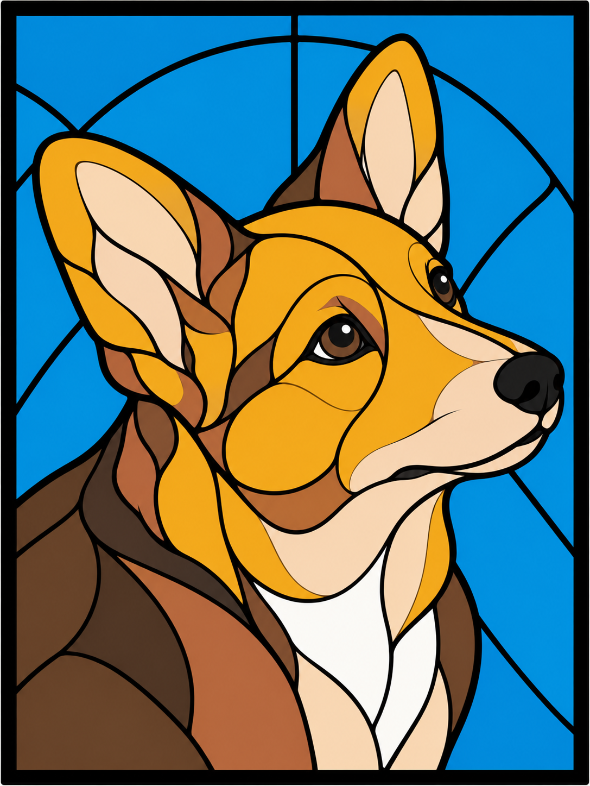

# 3D printed stained glass panels

Multicolor PLA panels developed through visual drafts, Bambu Studio slicing, and physical print feedback on a Bambu Lab H2D. This repository preserves the editable models, design inputs, experiments, and decisions needed to continue the work with an agent.

## Start here

- [Agent handoff and working rules](AGENTS.md)
- [Design history and lessons](docs/design-history.md)
- [Printing settings and troubleshooting](docs/printing.md)
- [Rebuilding and validating](docs/reproduction.md)
- [Artifact catalog with checksums](catalog.json)

## Current designs

| Design | Editable project or draft | Status |
|---|---|---|
| Original lion | [Arachne snug panel](outputs/lion-original-arachne-snug-ready-H2D.3mf) | Printed; user subsequently described the work positively. Arachne test A explicitly confirmed successful. |
| Original lion, clean color settings | [Updated project](outputs/lion-original-arachne-snug-clean-color-verified-H2D.3mf) | Sliced and verified; physical improvement not confirmed. Old AMS arrangement; remap and re-slice. |
| Winking and smirking lion | [Latest separated-nozzle project](outputs/lion-wink-clean-color-separated-nozzles-H2D.3mf) | Sent to printer on 2026-10-17. Completion and surface quality not yet recorded. |
| Both lion inserts | [Two-panel project](outputs/lion-lightbox-two-panels-H2D.3mf) | Earlier 108 × 144 mm panels; predates snug sizing and successful Arachne settings. |
| Corgi mix B | [Seven-color editable panel](outputs/corgi-B-arachne-snug-v2-verified-H2D.3mf) | Native-saved and slice-verified; not printed. [Design and material notes](docs/corgi-B.md). |

Current single-panel lion inserts are **108.2 × 144.2 × 2.5 mm**, with **0.8 mm color panes**. The housing and light guide remain in their projects on separate plates. The early square 200 mm lion is also archived.

## Repository layout

`outputs/` preserves the original filenames for all generated artifacts, including historical versions and validation reports. Use the table above or `catalog.json` to select a current file; a filename containing “ready” is not proof that it matches today's spool arrangement.

`work/` contains the original generation and validation scripts, supporting geometry, and Bambu Studio intermediate projects needed by those scripts. External input paths have been made repository-relative where practical. `sources/` contains the supplied lightbox project. `docs/` records conclusions and the workflow. `tools/verify_archive.py` checks archive integrity without printing or overwriting models.

Sliced `.gcode.3mf` files are historical evidence of specific printer and AMS configurations. Open an editable project, verify current materials and nozzle assignments, and re-slice before a future print.

## Provenance

Archived from the design conversation and workspace on 2026-10-17. Models were generated with Python geometry tools and configured, sliced, and saved in Bambu Studio; this workflow did not depend on a Fusion model. Lion artwork was inspired by Apple's lion emoji styling. The lightbox was supplied by the user; its upstream author and license were not recorded. No blanket license is asserted for third-party inputs. Personal reference photos are not bundled; the generated corgi drafts and detailed prompts preserve the design direction.
