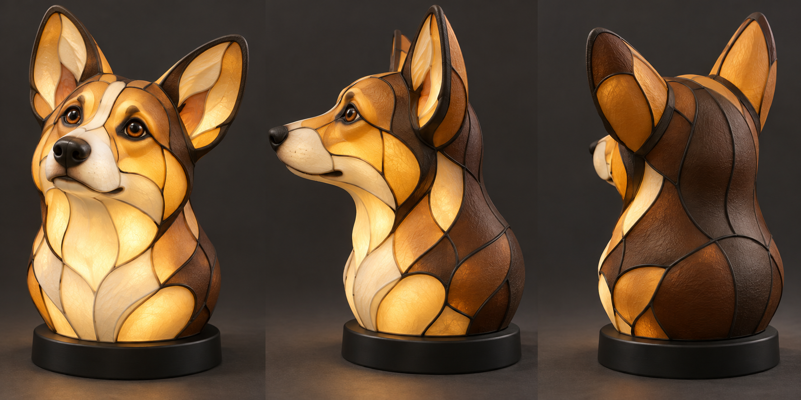

# Illuminated Corgi sculpture — concept v1

## Current direction, 2026-10-19

User corrected the interpretation: wants a true three-dimensional tabletop sculpture, not a flat picture lamp or a set of flat panels. This supersedes the arched picture-lamp enclosure proposal. Retain stained-glass appearance, commodity high-quality non-Bambu electronics, and no exposed-source light leaks.

One proposed hollow Corgi bust, shown front three-quarter, profile and rear three-quarter. The projecting muzzle, rounded cheeks/skull, thick upright ears, neck and finished back make a sculpture in the round. Approximately 250 mm high, 170 mm wide and 160 mm deep as an initial target. Warm translucent Gold/Champagne/White regions, dark Cocoa saddle/nape and opaque black ribs/nose/base. The dog is illustrative; exact likeness and proportions remain subject to user review.

Generated with the built-in image tool. [Exact prompt](prompt-v1.json). This is appearance exploration, not CAD, a printable model, a measured optical result or a guarantee that curved PLA will glow as rendered.

## Construction direction

[Electronics and weighted-base proposal](electronics-and-base.md): internal removable lighting core, external dimmer and Class 2-rated 24 V adapter, 190 x 175 x 30 mm starting base with captive steel ballast. This refines the earlier power-supply candidate; no components ordered.

- A hollow sculptural body with broad colored curved or gently faceted shell regions and connected black ribs wrapping around the full form.
- Break the shell into printable, serviceable sections with joints concealed beneath black leading. Overlap and seal joints to avoid unfiltered white leakage.
- Concealed internal diffuser and low-voltage lighting, accessible through the opaque weighted base.
- The previously researched premium 24 V LED strip, external supply and dimmer remain candidates. The flat LED backplate and planar optical stack do **not** carry over; develop an internal aluminum light core with distributed outward-facing emitters and test illumination of muzzle and ears.
- Prior Arachne/no-ironing/color-routing findings remain useful. Flat-pane thickness and toolpaths are not automatically validated for sloped or curved shell surfaces. Test the chosen curved-shell print orientation, wall thickness, translucency and joined seams before manufacturing the full sculpture.
- Thermal qualification and stability remain required; no new print has been authorized or sent.

The earlier picture-lamp design is preserved as superseded history at [picture-lamp](../picture-lamp/README.md).
