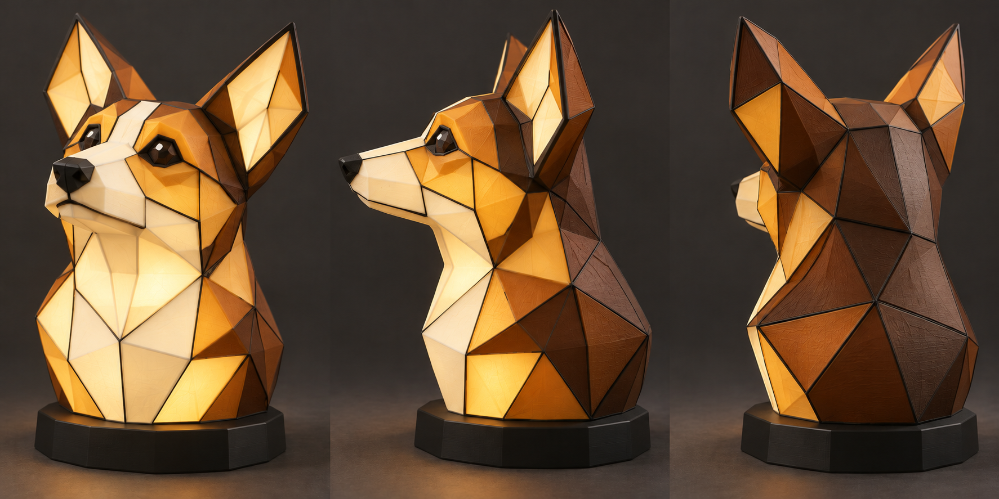

# Illuminated Corgi sculpture — planar-facet concept v2

## Current direction, 2026-10-19

User corrected the interpretation: wants a true three-dimensional tabletop sculpture, not a flat picture lamp or a set of flat panels. This supersedes the arched picture-lamp enclosure proposal. Retain stained-glass appearance, commodity high-quality non-Bambu electronics, and no exposed-source light leaks.

## Current geometric direction

User now requires **every stained-glass section to be flat**, and explicitly accepts a more abstract artistic interpretation. Keep the sculpture fully three-dimensional by assembling planar polygonal panes at different angles. This supersedes curved or bulging shell sections. Preserve the large attentive ears, long muzzle, warm palette and finished back.

Built-in image-tool edit of the prior concept; [exact v2 prompt](prompt-v2-planar.json). All apparent planes and part counts in the rendering remain illustrative, not CAD-verified. Start with broad triangles/quadrilaterals and approximately 35–45 main panes as a simplification target; exact count comes from manufacturable geometry.

### Manufacturing approach

- Model a closed polyhedral volume from explicitly planar faces. Each colored insert is printed flat, with one nominal thickness over its usable light-transmitting area. Dihedral angles between adjacent faces create the volume.
- A black structural edge frame carries the angled joints. Recessed ledges conceal insert edges and join clearances; joints must not leave direct white-light sightlines. Put assembly keys/identifiers on hidden frame tabs and retain service access.
- Use the successful flat-pane printing/transmission settings as a starting point, then verify attachment tolerances and assembled seam hiding. Narrow acute tips can terminate under opaque frame junctions instead of demanding unprintable tiny light-transmitting slivers.
- During CAD validation, check each insert's vertices against its own plane, wall thickness, positive/manifold solids, edge registration, closed assembled coverage and light-core/service clearances. A visually faceted rendering alone is not evidence that these checks pass.
- The removable internal lighting core and weighted base proposal remain applicable. Adjust emitter/diffuser locations to the final faceted cavity and test heat/uniformity before a full sculpture print.

### Previous curved concept (history)

[Three-angle v1 rendering](corgi-bust-three-views-v1.png) and its [prompt](prompt-v1.json) are preserved; its curved shell is superseded.

One proposed hollow Corgi bust, shown front three-quarter, profile and rear three-quarter. The projecting muzzle, rounded cheeks/skull, thick upright ears, neck and finished back make a sculpture in the round. Approximately 250 mm high, 170 mm wide and 160 mm deep as an initial target. Warm translucent Gold/Champagne/White regions, dark Cocoa saddle/nape and opaque black ribs/nose/base. The dog is illustrative; exact likeness and proportions remain subject to user review.

Generated with the built-in image tool. [Exact prompt](prompt-v1.json). This is appearance exploration, not CAD, a printable model, a measured optical result or a guarantee that curved PLA will glow as rendered.

## Construction direction

[Electronics and weighted-base proposal](electronics-and-base.md): internal removable lighting core, external dimmer and Class 2-rated 24 V adapter, 190 x 175 x 30 mm starting base with captive steel ballast. This refines the earlier power-supply candidate; no components ordered.

- A hollow polyhedral body with individually planar colored inserts and a black frame along the straight facet edges.
- Break the shell into printable, serviceable sections with joints concealed beneath black leading. Overlap and seal joints to avoid unfiltered white leakage.
- Concealed internal diffuser and low-voltage lighting, accessible through the opaque weighted base.
- The previously researched premium 24 V LED strip, external supply and dimmer remain candidates. The flat LED backplate and planar optical stack do **not** carry over; develop an internal aluminum light core with distributed outward-facing emitters and test illumination of muzzle and ears.
- Prior Arachne/no-ironing/color-routing findings remain useful. Print each insert flat; validate final face dimensions, attachment and assembled light sealing before manufacturing the full sculpture.
- Thermal qualification and stability remain required; no new print has been authorized or sent.

The earlier picture-lamp design is preserved as superseded history at [picture-lamp](../picture-lamp/README.md).

## CAD status

The user rejected both CAD v1 and v2 for likeness. [CAD revision 3](cad-v3/README.md) starts over with explicit anatomical landmarks and connected planar patches. Native Fusion archive, STEP and screenshots are saved for visual review. It is not yet user-approved or a manufacturing-ready lamp; joints, lighting, thermal and stability work remain. No sculpture print sent.
