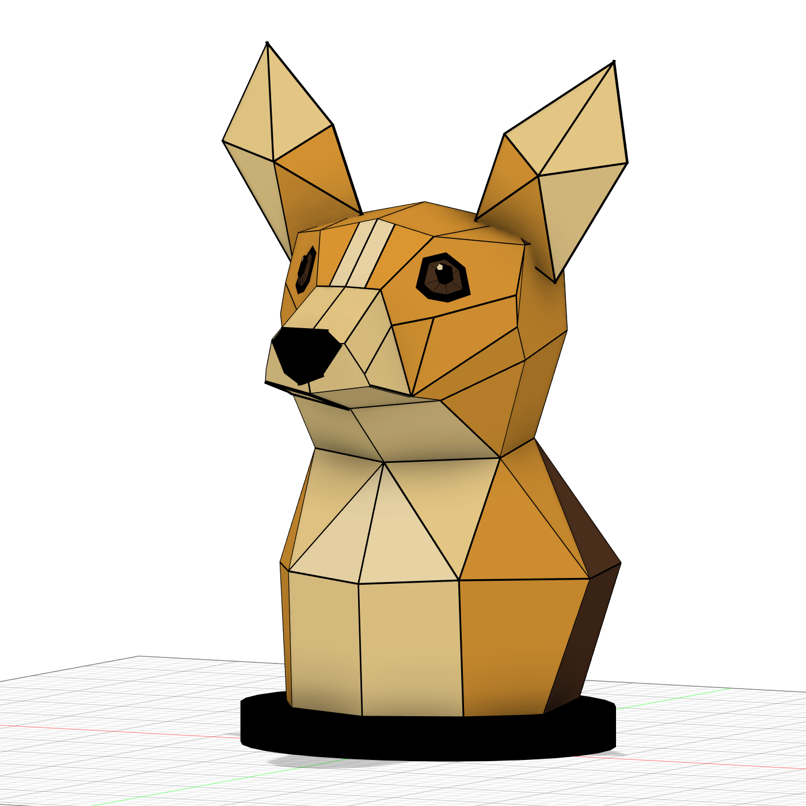

# Corgi sculpture: landmark reconstruction v3

**Current status: native Fusion form study for visual review. Not approved, printable assembly, or qualified lamp.**

The user rejected v1 and v2 because their shapes did not match the approved concept. V3 starts with a new anatomical landmark network, using [the approved three-view rendering](../corgi-planar-facets-three-views-v2.png) as the reference. It does not reuse the old ring-stack head/body mesh.

## Files

- [Editable Fusion archive](corgi-form-revision-v3.f3d)
- [Native Fusion STEP export](corgi-form-revision-v3.step)
- [Profile](fusion-side.png) / [rear](fusion-rear.png)
- [Three-view geometry preview](cad-three-views.png), software rasterized; not a predicted illuminated appearance.
- [Geometry and palette](form-study.json), [exact body meshes](fusion-body-input.json), [native validation](fusion-validation.json).

## Changed form

Sloping forehead and narrower cream blaze; fuller tapered muzzle; closed mouth following shared panel edges; eyes inset into planar facial patches; folded, volumetric ears with broad roots; projecting chest and wider shoulders. The brown saddle continues around the back. This remains a simplified interpretation of an inconsistent generated three-view image, not an exact reconstruction. The source's softer cheek transitions and expression remain visual-review points.

Nominal height about 309 mm, plinth 172 x 150 x 18 mm. These are form-study dimensions, not final electronics packaging. All colored facets are planar; broad adjacent patches share optimized landmarks instead of independent arbitrary planes. 233 individually closed native solids were created and their positive volumes matched source meshes to relative error below 1.3e-9. This does not establish a sealed, interference-free assembly.

## Outstanding engineering

Pane ledges, opaque overlapping seams, assembly modules, ear-root intersections, hidden retainers, diffuser, aluminum LED core, service access, thermal behavior and stability still need design and validation. The plinth is a solid appearance envelope, not an engineered enclosure. No slicer validation, light-leak test, print or hardware purchase occurred. Keep this out of models/ until qualified.

The successful flat-pane thicknesses remain starting assumptions: 0.4 mm light colors and 0.3 mm Cocoa. Iris is a visualization shade, not a newly verified filament. Existing premium 24 V electronics remain provisional; the old base dimensions must not be assumed to fit this new shape.

## Reproduce

Install source/requirements.txt in a Python environment; run source/rebuild_landmarks.py. Set OPENBLAS_NUM_THREADS=1 for efficient landmark optimization. The build.py file supplies geometry helpers and the deterministic renderer; do not run it as a separate model builder. Run source/fusion_build.py in a separate empty Fusion design in batches until its reported target is reached, then fusion_finish.py. Fusion scripts contain this workstation's output path and must be changed on another machine. Preserve earlier native archives and unrelated open documents.
