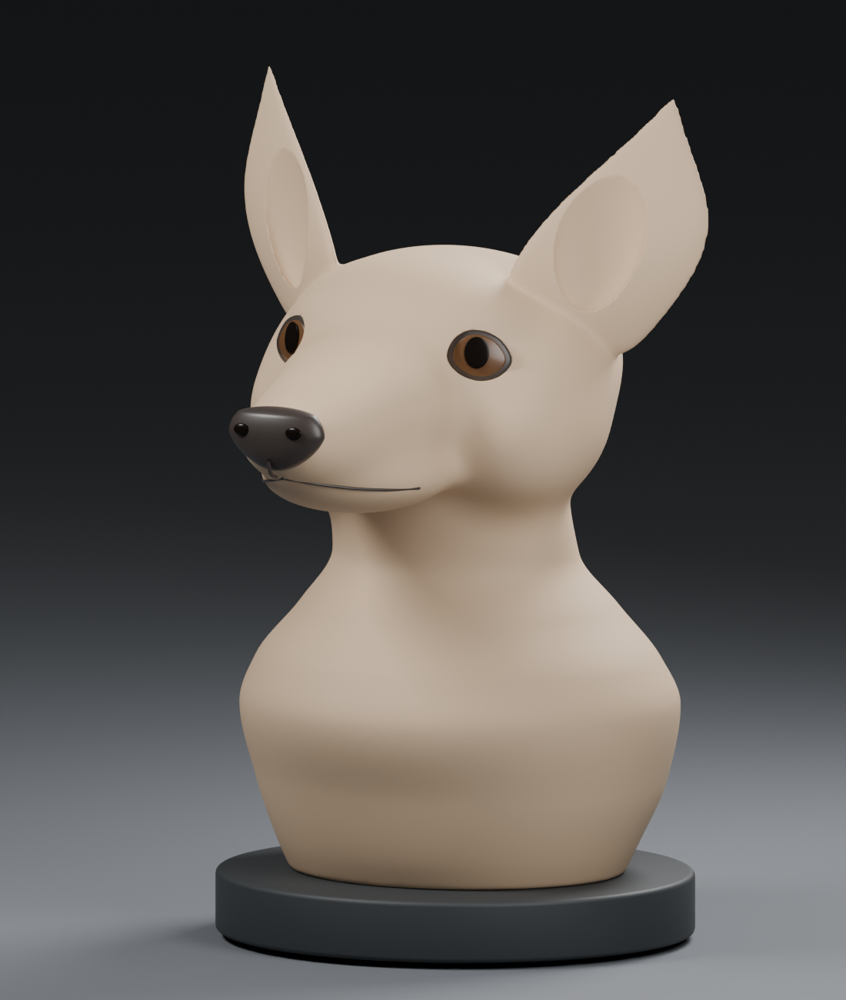

# Continuous Corgi form study v4

**Visual review of anatomy and expression, before stained-glass divisions.** The user rejected CAD v1, v2 and v3 for poor likeness. The user accepted the proposed change in method: build a continuous sculptural form first, then divide the approved form into flat panels. The approved [three-view concept](../corgi-planar-facets-three-views-v2.png) remains the target.

[Profile](profile.png) / [front](front.png) / [rear](rear.png) / [comparison with the concept](concept-comparison.png)

## Editable model

- [Blender master](corgi-continuous-form.blend), including editable mesh, facial components, cameras, clay materials and studio lighting.
- [Fusion mesh archive](corgi-continuous-form-mesh.f3d), for inspection in Fusion. This is a mesh reference, not an editable parametric BRep or a T-spline sculpt.
- [Main sculpt mesh in millimeters](corgi-continuous-form-mm.stl), including head/body/ears with orbital and ear recesses. Separate eyes, nose, mouth details and plinth are in the Blender master; the STL alone does not include them. This is an auxiliary reference export with a known nonmanifold edge at an ear recess; do not print it.

## Method and evidence

The torso silhouette and tapered muzzle use interpolated contours. Skull, forehead, cheeks and jaw blend through a smooth implicit field rather than joining polygonal panels. Ears have thickness, twist and recessed bowls. Eye openings are shaped independently from the brown lenses and pupils. Body details are intended to develop the form; they are not final filament assignments.

The images are ordinary Blender renders of the saved geometry, not generated artwork or a prediction of transmitted light. The comparison places the original concept beside these actual renders. Camera angles are approximate. The concept's different views are not fully geometrically consistent; no exact reconstruction or likeness approval is claimed.

Main surface closedness and volume are recorded in [sculpt validation](sculpt-validation.json); [implicit anatomy evidence](anatomy.json) describes the initial surface. The native body has closed topology, but the auxiliary STL has one coincident edge at an ear recess after triangulation. That export needs retopology before any manufacturing use. These checks do not establish artistic likeness or a manufacturable lamp. Judge skull/muzzle proportions, ear roots and spread, eye expression, throat and chest before adding facets.

This is a solid form study. It has no engineered hollow cavity, planar inserts, opaque seam joints, electronics mounting, service access, ballast retention or heat validation. The plinth is an appearance envelope. The eventual colored sections must still all be flat. Existing successful thin-pane print findings remain useful only after that design stage. No print or purchase has been authorized or triggered.

## Reproduce

Install source/requirements.txt into a Python environment and run source/sculpt_field.py. Then run source/sculpt_form.py through Blender 4.5's background Python interface. The second script builds and renders the continuous sculpt using the generated anatomy STL. The source uses this repository's layout; an optional sibling work/pydeps folder is added to Python's search path. Normal installed dependencies also work. Use OPENBLAS_NUM_THREADS=1 for the first script. Blender scene length scale is 0.1 meters per unit; the STL and Fusion import explicitly use millimeters. Portable Blender was downloaded from the official Blender distribution and its SHA-256 checked; the runtime is not included in this repository.
