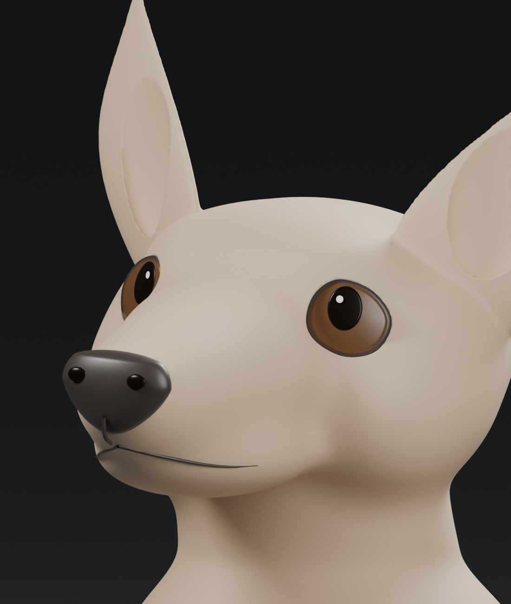

# Corgi expression study v5

The user found v4's proportions closer but its expression ineffective. This revision retains the main anatomical volumes and develops the attentive, upward-looking puppy expression.

[Full sculpture view](three-quarter.png) / [front view](front.png)

## Changes

The eye openings are wider and taller, with more open inner upper lids. The larger pupils look upward toward the human and carry small cream catchlights. The pupils conform to the brown lenses to avoid the clipping seen during the working render. A subtle continuous inner-brow lift and a restrained sideways/upward head inclination add attentiveness. The closed mouth is shorter and tapers at its corners.

The actual geometry renders remain clay studies. This is awaiting expression review; the user has not approved this likeness or a final lamp. Final colored sections must still be planar. No lamp assembly, slicing, print or electronics purchase occurred.

## Editable files

- [Blender sculpt and facial components](corgi-continuous-form.blend): editable mesh master with cameras and clay studio materials.
- [Fusion mesh reference](corgi-expression-mesh.f3d): imported assembly mesh for inspection, not parametric CAD or a T-spline sculpt.
- [Expression parameters and feedback](expression-notes.json).
- [Native main-surface topology snapshot](sculpt-validation.json), which does not establish likeness, sealed joints or manufacturing readiness.

Raw STL/OBJ exports are working files and are excluded. The previous STL ear-recess export issue has not been resolved or promoted; this task concerns expression. The base is an appearance envelope. Hardware, cavity, flat panes, seam coverage and heat/stability design remain for a later stage.

## Reproduce

Install source/requirements.txt into Python and run source/sculpt_field.py to regenerate the v4 anatomical base. Run source/sculpt_expression.py using Blender 4.5 background Python to generate the v5 sculpt and three actual geometry views. source/export_form.py exports the assembly for importing to Fusion with millimeter units. The Blender scene uses 0.1 meters per scene unit. Sources resolve the repository from this folder layout; the optional sibling work/pydeps path is retained for this workstation.
