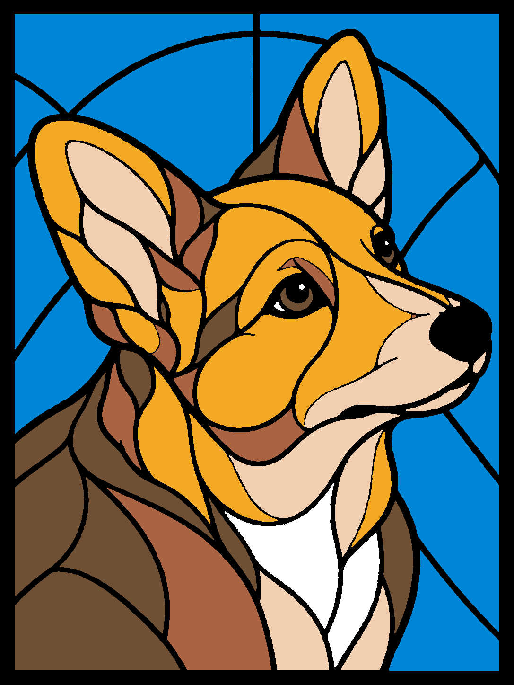

# Corgi B: at your side

Latest editable project: [corgi-B-arachne-snug-v2-verified-H2D.3mf](../archive/outputs/corgi-B-arachne-snug-v2-verified-H2D.3mf).

## Design and status

The approved upward-right portrait is now seven flat color solids with connected black leading and a black outside edge. Dimensions are 108.2 × 144.2 × 2.5 mm; colored panes are 0.8 mm. The housing and light guide were retained from the latest lion project on their separate plates. Plate 1 prints only the insert and purge tower.

Generated, opened, saved, and sliced in Bambu Studio on 2026-10-17. Seven watertight, consistently wound positive-volume meshes; no modeled gaps or overlaps. Native dimensions and exported material routing verified. Estimate: 13,262 seconds (3 h 41 m 2 s), 54.59 g including waste, 24 layers. **Not sent to the printer; no physical result yet.** Actual AMS loading has not been verified for this palette.

The Studio viewport captured blank white, so inspection used the exported meshes and a separately rasterized G-code projection. The geometry preview above is an actual flat rendering of the manufacturing polygons, not a photograph or translucency prediction.

## Filaments

| Project slot | Owned material | Code | Intended nozzle |
|---|---|---|---|
| 1 | PLA Basic Jade White | 10100 | Right |
| 2 | PLA Basic Cyan | 10603 | Right |
| 3 | PLA Silk+ Gold | 13405 | Right |
| 4 | PLA Silk+ Champagne | 13404 | Right |
| 6 | PLA Basic Cocoa Brown | 10802 | Left |
| 7 | PLA Basic Black | 10101 | Left |
| 8 | PLA Metal Copper Brown Metallic | 13800 | Left |

Slot 5 is the retained dark-gray housing material and is unused by the panel. Project slots are **not AMS bay numbers**. Gold, Champagne, and Copper need appropriate physical loading and text-based identity checks before printing. Inventory evidence is in the earlier palette JSON; verify current quantities before use.

Silk+ uses the installed H2D Silk+ profile: 230 C and 12 mm³/s maximum volumetric speed. Metal uses its own H2D profile at 220 C. Black retains the clean-color trial's 220 C first layer, 215 C subsequent layers, 0.6 mm retraction and 2 mm wipe. The other Basic colors use their H2D profiles at 220 C. Temperature and feed limits were checked in the native project and exported settings.

## Junctions, surfaces, and first print

Arachne, zero seam gap, 0.1 mm layers (0.2 mm first layer), 100% infill, and no ironing carry over from the successful lion baseline. Dark and light filament groups use separate nozzles. Prime volumes remain 45/90 mm³; flushing into the object and infill is disabled. Conservative purge matrices use 900 mm³ for dark-to-white/gold/champagne and 600 mm³ for other non-diagonal transitions; these are trial values, not calibrated minima.

The corgi has finer details than the lion. Black boundaries were expanded 0.12 mm per side, and color tips rounded with a 0.20 mm morphological opening before the final partition. There is no buried black ledge. This is specific to the new corgi geometry and does not alter the successful lion files.

The diagnostic nominal toolpath projection still reports 48.9424 mm² of uncovered pixels over the panel interior at 0.04 mm resolution, distributed among small junctions and edges. The unrounded trial measured 48.1408 mm², so rounding did **not** demonstrate a reduction in this metric. Pink in the diagnostic toolpath PNG denotes nominal voids, not a filament. This calculation is not a physical pinhole guarantee and is sensitive to path-width/raster assumptions. Inspect ear tips, eye highlights, muzzle and chest junctions under backlighting on the first print before declaring this design successful.

Silk+ and Metal can transmit light differently from Basic; the seven-color appearance and 0.8 mm panes do not establish equal translucency. The first print should also confirm fit, retained eye highlights, surface quality and dark-color contamination.

## Files and iteration

Use the v2 verified native project for editing. The generated `-H2D.3mf` is the pre-native source; the `-v2-sliced.gcode.3mf` is slice evidence. Recheck loaded materials and re-slice before sending a future job. The part ZIP contains seven aligned STLs: import together as one multipart object to preserve registration. The SVG preserves the manufacturing partition, and the PNG shows its flat colors.

`archive/work/build_corgi.py` regenerates geometry from the library-palette rendering and the separated-nozzle lion template. `archive/work/validate_corgi.py` validates the native model and slice; `archive/work/check_corgi_toolpaths.py` generates the diagnostic projection. Read the validation JSON for hashes and evidence limits. Earlier local corgi files without `v2` in their native/sliced filenames are superseded and were not promoted into this repository.

## 2026-10-18: full simplified Corgi production v6

User requested best-product assumptions for an overnight full panel and authorized printing on a clear ready bed. Rebuilt from approved `corgi-simplified-review-v2.png`; removed raster shading seams, retained two printable 1.2 mm eye highlights, merged near-opaque Copper into Cocoa. Geometry uses a 0.01 mm partition grid; regions cover the outline without area overlap. All solids are watertight, consistently wound and positive volume. Native saved geometry and 221,331 actual model extrusion segments checked.

Panel stays 108.2 × 144.2 mm with 2.6 mm wide, 2.5 mm tall black rim. Light panes 0.4 mm, Cocoa 0.3 mm, interior leading 0.7 mm (0.3 mm relief over light panes). Dual standard 0.2 mm nozzles; 0.1 mm first/all layers, Arachne, no ironing, 100% infill, 20% overlap, zero seam gap. White flow 1.0094; all other materials 0.98. Dark/light nozzle separation, 215°C subsequent black, 0.6 mm black retraction/2 mm wipe, avoid wall crossing and retraction reduction Disabled. Standard material-specific 0.2 profiles and conservative 2 mm³/s volume limit. Purge into tower only, not artwork.

Live material dialogs verified A1 Champagne Silk+, A2 Jade White Basic, A3 Gold Silk+, A4 Cyan Basic, B4 Cocoa Basic and B2 Black Basic. Send dialog matched those slots to right lights/left darks. Bed leveling/flow dynamics On, nozzle offset Auto, timelapse Off. Sent ONCE about 22:41 local. Studio reported successful send; Haute showed the correct production-v6 job heating/homing at 0/25. Estimate 4h34m21s and 27.49 g; indicated finish about 03:15. Completion and physical result remain unconfirmed. No other job queued.

V4 +3% white physically eliminated angle-dependent seam pinholes per user. V5 completed with a small dark spot even without active black deposition; source unresolved. These remain distinct findings: do not claim the full colored panel is physically proven or the dark-spot cause fixed. This product print intentionally proceeds with the best present assumptions instead of further diagnosis. Current human download: [Corgi model](../models/corgi/README.md). Original housing/light-guide and historical projects are untouched; v6 is a standalone insert project.
