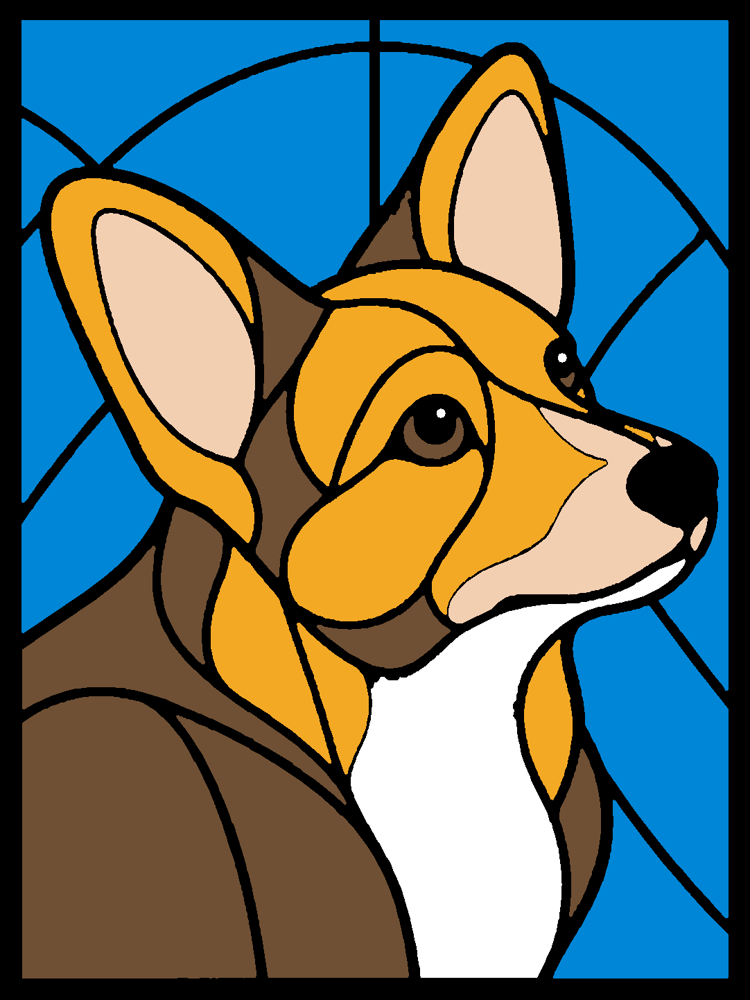

# Corgi B — simplified production v6

## [Download editable H2D project](panel-H2D.3mf)

**Status:** Native-saved and slice-verified. Sent once on 2026-10-18 at about 22:41 local; Haute showed heating/homing at layer 0/25. User confirmed on 2026-10-19 that the completed panel turned out really well. This is general positive feedback; no detailed new defect audit was supplied. Estimated duration 4h34m21s, 27.49 g including purge.

108.2 × 144.2 mm insert, 2.5 mm maximum at the black perimeter. White, Cyan, Gold and Champagne panes are 0.4 mm; Cocoa is 0.3 mm. Interior black leading is 0.7 mm, giving 0.3 mm relief over the light panes. The black outer border is 2.6 mm wide and 2.5 mm tall. This standalone project contains only the panel. Original housing/light-guide projects remain unchanged in the archive.

Dual standard 0.2 mm nozzles; 0.1 mm first and subsequent layers; Arachne, 100% infill, 20% infill/wall overlap, zero seam gap, no ironing. White flow ratio 1.0094 (tested +3% over 0.98); other materials retain 0.98. Copper was replaced with Cocoa because Copper remained nearly opaque in backlit tests. Simplified artwork removes raster shading seams and retains two 1.2 mm eye highlights.

### Verified spool mapping at send

| Nozzle | Slot | Material |
|---|---|---|
| Right | A2 | Bambu PLA Basic Jade White |
| Right | A4 | Bambu PLA Basic Cyan |
| Right | A3 | Bambu PLA Silk+ Gold |
| Right | A1 | Bambu PLA Silk+ Champagne |
| Left | B4 | Bambu PLA Basic Cocoa Brown |
| Left | B2 | Bambu PLA Basic Black |

Black uses 220°C first layer, 215°C afterward, 0.6 mm retraction and 2 mm wipe. Basic lights/Cocoa use 220°C; Silk+ uses 230°C. Maximum volumetric speed 2 mm³/s. Conservative purge volumes and a separate prime tower; no purging into the artwork. Bed leveling and flow calibration On; nozzle offset Auto; timelapse Off.

**Remaining uncertainty:** An occasional small dark spot persisted even in the latest white-only test after nozzle/wiper/flow-blocker cleaning. Its source is unresolved. The +3% correction eliminated pinholes in the user's two-color coupons, but Gold/Champagne and this complete panel do not yet have equivalent physical confirmation. Dark Cocoa is expected to transmit weakly.

Flat color preview, not a prediction of illuminated appearance.

[Validation record](../../archive/outputs/corgi-production-v6-02mm-validation.json) · [Saved source](../../archive/outputs/corgi-production-v6-02mm-H2D.3mf) · [Printing lessons](../../docs/printing.md) · [All models](../README.md)

The download is byte-identical to the archived native source. Recheck hardware and loaded materials and re-slice for a future print. This record does not authorize another send.
