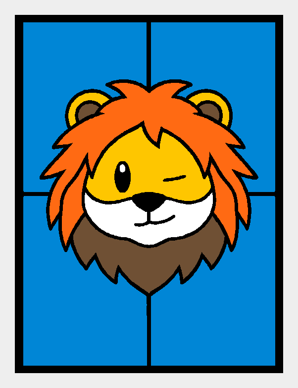

# Winking and smirking lion

## [Download editable H2D project](panel-H2D.3mf)

108.2 × 144.2 × 2.5 mm insert, 0.8 mm colored panes. Arachne walls, zero seam gap, 0.1 mm layers with a 0.2 mm first layer, no ironing. The housing and light guide remain on separate plates; choose plate 1 for the panel.

**Status:** Latest separated-nozzle version was sent to the printer. Completion and physical result are not recorded.

**Materials:** PLA Basic Jade White, Cyan, Sunflower Yellow, Orange, Cocoa Brown and Black.

Open the project in Bambu Studio, verify the current AMS material names and nozzle groups, and re-slice. This is an editable project, not a pre-authorized print job. Preserve the intended dark/light nozzle separation.

Artwork preview; the download is the adapted rectangular lightbox insert.

[Back to all finished models](../README.md) · [Printing notes](../../docs/printing.md)

Source preserved at [`lion-wink-clean-color-separated-nozzles-H2D.3mf`](../../archive/outputs/lion-wink-clean-color-separated-nozzles-H2D.3mf). The downloadable project is an exact copy; hashes are in the root catalog.
