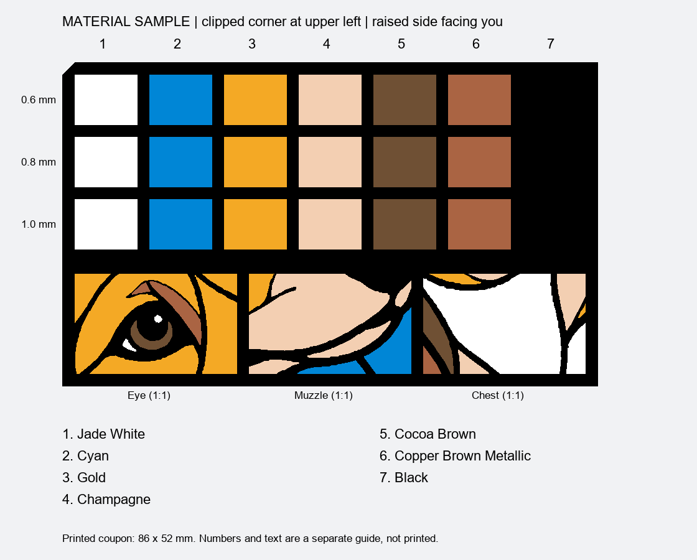

# Corgi material and junction sample

## [Download editable H2D sample](sample-H2D.3mf)

An **86 × 52 mm** coupon with 21 thickness patches and three actual corgi detail crops. It uses the same seven materials and Arachne/no-ironing settings as the full corgi. The user confirmed completion and reported pinholes and excessive black relief; see the physical feedback below. Verify the current AMS loading before any reprint.

## Read the sample

Hold the raised face toward you, with the clipped corner at the **upper left**. The numbers and text in the guide are not printed on the coupon. The black patches are recessed into the black frame and can be identified by position and touch.

- Top row: **0.6 mm**.
- Middle row: **0.8 mm**, matching the current corgi panes.
- Bottom row: **1.0 mm**.
- Below the grid: **eye, muzzle, chest**, left to right, cropped at original scale. Colored regions are 0.8 mm and black leading is 2.5 mm.

| Column | Material | Product code | Project slot | Nozzle |
|---|---|---|---|---|
| 1 | PLA Basic Jade White | 10100 | 1 | Right |
| 2 | PLA Basic Cyan | 10603 | 2 | Right |
| 3 | PLA Silk+ Gold | 13405 | 3 | Right |
| 4 | PLA Silk+ Champagne | 13404 | 4 | Right |
| 5 | PLA Basic Cocoa Brown | 10802 | 6 | Left |
| 6 | PLA Metal Copper Brown Metallic | 13800 | 8 | Left |
| 7 | PLA Basic Black | 10101 | 7 | Left |

Project slots are not AMS bays. Slot 5 is unused. Match material names and codes in the printer mapping; do not identify spools solely by swatch color.

## Evaluate after printing

1. Let the coupon cool, then inspect the raised and plate-facing surfaces for stringing, dark streaks, lifting and loose junctions.
2. Hold it against the same lightbox/diffuser at the intended panel distance. Keep light brightness and viewing angle fixed.
3. Compare each column vertically. Record which thickness gives useful glow without visible infill or bright pinholes. Check black for unwanted glow too.
4. Inspect the eye, muzzle and chest seams with backlighting. Note missing highlights, detached thin pieces or pinpoint leaks by crop name and position.
5. Compare the seven middle-row patches with the light on and off. Evaluate brightness separately from hue. A helper or a fixed-exposure photograph can assist with hue judgments; refer to column numbers.

Use [results.csv](results.csv) to record observations. Blank cells mean untested, not passed. Photographing all patches together with fixed exposure gives a useful comparison; it is not an absolute transmission measurement.

## Printing and limits

Open `sample-H2D.3mf`, confirm H2D dual standard 0.4 mm nozzles/textured PEI and the material mapping, then slice. Keep Arachne, seam gap 0%, 0.1 mm layers/0.2 mm first layer, 100% infill, no ironing, and the separate dark/light nozzle groups. Silk+ and Metal have their own material profiles.

Studio estimates **2 h 44 min and 47.51 g total filament**, including purge/tower overhead. Seven-color changes and conservative purging mean waste can outweigh this small coupon. The sample tests local material behavior and junctions; it does not establish full-panel fit, warping, or the exact thermal conditions of a larger print. [Validation report](validation.json) records the slice estimate and checks. Archived G-code is evidence, not the download to send blindly.

[Finished panels](../../models/README.md) · [Full corgi notes](../../docs/corgi-B.md)

## Physical feedback received

The user confirmed this sample completed and reported pinholes near narrow turn-arounds and excessive black relief around the eye. Transmission varied substantially; exact swatch identities need confirmation. See the [next junction test](../junction-v2/README.md) and its controlled comparison plan. Earlier validation files remain historical snapshots.
